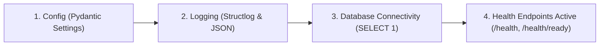

# Architecture Overview

## Overview

Prism is an open-source, self-hosted AI evaluation and observability platform designed to sit between production applications and Large Language Model (LLM) providers. It intercepts and records every prompt, completion, token count, latency metric, and cost calculation, while offering automated evaluation pipelines (including golden dataset matching, heuristic checks, and LLM-as-a-judge), dynamic A/B routing with automated fallback/rollback, and comprehensive real-time observability dashboards.

## How the Backend Boots

The Prism backend follows a structured, deterministic lifecycle from initial process launch to serving incoming requests:



1. **Config (`app.core.config.Settings`)**:
   - The application instantiates `Settings`, powered by `pydantic-settings`.
   - Configuration values are loaded hierarchically from environment variables and `.env` files (both root `.env` and `backend/.env`).
   - Strict validation verifies environment-specific prerequisites (such as non-empty `DATABASE_URL` in staging and production).

2. **Logging (`app.core.logging.configure_logging`)**:
   - When the FastAPI application lifespan begins (`lifespan` in `app.main`), structured logging is initialized.
   - `structlog` and `python-json-logger` format logs consistently across all environments.
   - `RequestIDMiddleware` generates or extracts incoming `X-Request-ID` headers and binds them to the async logging context for end-to-end request tracing.

3. **Database (`app.db.session.engine`)**:
   - An asynchronous SQLAlchemy engine (`asyncpg`) initializes the connection pool.
   - As part of the lifespan startup hook, a lightweight connectivity probe (`SELECT 1`) is executed against the database.
   - If database connectivity fails in staging/production, application startup fails fast; in development, connection errors are logged while allowing the server to boot.
   - During application shutdown, the lifespan hook cleanly disposes of the database engine and connection pool.

4. **Health (`app.api.v1.health`)**:
   - Once startup completes, FastAPI exposes two health endpoints:
     - **Liveness (`GET /health`)**: A pure liveness check returning `{"status": "ok"}` with status code `200` without querying the database, indicating the process is running.
     - **Readiness (`GET /health/ready`)**: Verifies active database availability with an executed `SELECT 1` query, returning `200` (`{"status": "ready", "db": "ok"}`) when ready and `503` if the database is unreachable.

## Tenancy Model

Prism uses a four-level ownership hierarchy that isolates data between customers and controls access to API keys.

```
Organization
└── Project
    ├── Environment (dev)      ← default
    ├── Environment (staging)
    ├── Environment (prod)
    └── APIKey  ──────────────── scoped to one Environment
```

### Entities

| Entity | Table | Unique constraint | Notes |
|---|---|---|---|
| **Organization** | `organizations` | `slug` (global) | Top-level tenant. Every other resource belongs to exactly one org. |
| **Project** | `projects` | `(organization_id, slug)` | Logical workspace within an org. |
| **Environment** | `environments` | `(project_id, name)` | Fixed set: `dev`, `staging`, `prod`. Auto-created on project creation; `dev` is the default. |
| **APIKey** | `api_keys` | — | Scoped to a single Project + Environment pair. Only the SHA-256 hash and an 8-character public prefix are stored; the plaintext is shown once at creation and is unrecoverable. |

### Rules

- An **Organization** must exist before any Project, User, or APIKey can be created.
- A **Project** is always created with all three Environments in a single atomic transaction.
- The **default Environment** (`dev`) cannot be deleted until a different environment is promoted to default first.
- An **APIKey** is permanently linked to one Environment and cannot be moved; it can only be revoked.
- **Users** belong to an Organization (not a Project) and carry a role (`OWNER`, `ADMIN`, `MEMBER`, `VIEWER`).

## Layering

All backend code follows a strict five-layer stack. Imports only flow **downward** — no layer may import from a layer above it.

```
┌─────────────────────────────────────┐
│              API Layer              │  app/api/
│  FastAPI routers, request parsing,  │
│  response serialization (Pydantic)  │
├─────────────────────────────────────┤
│            Service Layer            │  app/services/
│  Business logic, validation rules,  │
│  unit-of-work / transaction mgmt    │
├─────────────────────────────────────┤
│          Repository Layer           │  app/repositories/
│  Async SQLAlchemy queries, CRUD,    │
│  pagination, flush/commit/rollback  │
├─────────────────────────────────────┤
│            Model Layer              │  app/models/
│  SQLAlchemy ORM declarative models  │
│  and domain enums                   │
├─────────────────────────────────────┤
│           Database (Postgres)       │
│  Tables, indexes, constraints,      │
│  JSONB columns, foreign keys        │
└─────────────────────────────────────┘
```

### Layer responsibilities

| Layer | Package | Allowed imports |
|---|---|---|
| **API** | `app.api` | Services, Schemas, Exceptions, FastAPI |
| **Service** | `app.services` | Repositories, Schemas, Models (types only), Exceptions |
| **Repository** | `app.repositories` | Models, SQLAlchemy (`sqlalchemy.*`) |
| **Model** | `app.models` | SQLAlchemy ORM declarations, Enums |
| **Schema** | `app.schemas` | Pydantic only |

### The golden rule — services never import SQLAlchemy directly

Services are the only layer that contains business logic. They must remain **database-agnostic** so that they can be unit-tested without a real database and so that the storage engine can be swapped without touching business rules.

Concretely:

- ✅ A service **may** call `await self.repo.create(...)`, `await self.repo.list(...)`, etc.
- ✅ A service **may** import model classes for type annotations.
- ❌ A service **must not** import `sqlalchemy`, `AsyncSession`, `select`, or any other SQLAlchemy symbol for use in query construction.
- ❌ A service **must not** call `session.execute(...)` or `session.flush()` directly.

The only exception is the `AsyncSession` type annotation in `__init__` signatures — this is accepted because it is used exclusively for dependency injection (the session is passed in, not created).

### Transaction semantics (unit of work)

Every mutating service method wraps its repository calls in `async with self.repo.transaction()`. The `transaction()` context manager on `BaseRepository` commits on success and rolls back on any exception — whether a domain `PrismException` or an unexpected `IntegrityError`. This means:

- Callers never need to manage commits or rollbacks.
- Partial writes are impossible within a single service operation.
- Tests can wrap operations in a savepoint and roll back cleanly after each test.

## Auth & RBAC

Prism implements a comprehensive, defense-in-depth authentication and role-based access control (RBAC) model.

### Authentication Model

Prism enforces a dual authentication model tailored for humans and machines:

1. **User Authentication (JWT)**:
   - Intended for human users interacting with the management APIs and web console.
   - Users authenticate with their email and password via `POST /v1/auth/login`. Passwords are verified against Argon2id hashes.
   - Upon successful verification, the API issues a signed JSON Web Token (JWT) using the `HS256` algorithm (configurable via `JWT_ALGORITHM` and `SECRET_KEY`).
   - Tokens carry standard claims: `sub` (User UUID), `org_id` (Organization UUID), `role` (UserRole), `exp` (expiration timestamp), and `iat` (issued-at timestamp).
   - Protected endpoints authenticate requests via the `Authorization: Bearer <token>` header, resolved by the `get_current_user` FastAPI dependency.

2. **Machine Authentication (API Keys)**:
   - Intended for backend services, SDKs, agentic pipelines, and proxy middleware making automated calls.
   - API keys are scoped to a specific `(Project, Environment)` pair and carry machine-level authorization.
   - Clients supply their key via the `X-API-Key` HTTP header.
   - Verified by the `get_current_api_key` dependency which eagerly resolves project and environment context.

### Role Hierarchy

Prism defines an organization-level role hierarchy:

```
OWNER > ADMIN > MEMBER > VIEWER
```

| Role | Privileges | Example Actions |
|---|---|---|
| **`OWNER`** | Full organization control, billing, destructive operations, role management. | Transfer organization ownership, manage all projects, invite admins, create/revoke any API keys. |
| **`ADMIN`** | Management of projects, environments, API keys, and members. | Create and revoke API keys (`/v1/keys`), manage projects, invite members and viewers. |
| **`MEMBER`** | Standard operational contributor. | Run evaluations, view traces, log prompts, interact with development environments. |
| **`VIEWER`** | Read-only observer. | Inspect metrics, review evaluation results, inspect audit logs and dashboards without mutation privileges. |

Role enforcement is handled via the `require_role(*roles)` dependency factory in `app.api.deps`. Routes decorated with `require_role(UserRole.OWNER, UserRole.ADMIN)` reject callers holding `MEMBER` or `VIEWER` roles with HTTP 401 `AuthError`.

### API Key Architecture

API keys follow a strict format engineered for security, usability, and constant-time database lookup:

```
prism_<env>_<prefix12>_<secret32>
```

- **Prefix**: `prism_<env>_<prefix12>` (e.g. `prism_dev_a1b2c3d4e5f6`).
  - Stored in the indexed `key_prefix` column.
  - Allows the database to locate the exact candidate key record in $O(1)$ time without scanning tables or performing expensive comparisons across inactive keys.
- **Secret**: 32 cryptographically secure, URL-safe random characters (`secrets.token_urlsafe`).
- **Plaintext Key**: Returned **exactly once** in the response body of `POST /v1/keys`. It is never logged and never stored in plaintext.
- **Verification**: The database stores `hashed_key`, which is the SHA-256 digest (`hashlib.sha256`) of the full plaintext key. Verification uses timing-attack-resistant constant-time comparison (`hmac.compare_digest`).

### Consistent Error Response Shape

All API errors return a uniform JSON error envelope across the entire platform:

```json
{
  "error": {
    "type": "<ExceptionClassName>",
    "message": "<human-readable explanation>",
    "details": {}
  }
}
```

Standard domain exception mappings:

| Exception | HTTP Status | Response Header | Description |
|---|---|---|---|
| `AuthError` | `401 Unauthorized` | `WWW-Authenticate: Bearer` | Invalid credentials, account inactive, or insufficient RBAC privileges. Prevents user enumeration by using uniform messages. |
| `TokenError` | `401 Unauthorized` | `WWW-Authenticate: Bearer` | Expired, forged, or malformed JWT access token. |
| `NotFoundError` | `404 Not Found` | — | Requested resource (e.g., Organization, Project, API Key) does not exist. |
| `ConflictError` | `409 Conflict` | — | Conflict with existing state (e.g., duplicate slug or duplicate active resource). |
| `ValidationError` | `422 Unprocessable Entity` | — | Business validation failure (e.g., password below minimum length). |
| `PrismException` | `400 Bad Request` | — | Fallback catch-all for any unhandled Prism domain exception. |

### Authentication Sequence Diagram

The following sequence illustrates a user authenticating, receiving a JWT token, and querying a protected endpoint:

```
+--------+             +--------------------+             +----------+             +----------------------+
| Client |             |   /v1/auth/login   |             | Database |             |   Protected Endpoint |
+--------+             +--------------------+             +----------+             +----------------------+
    |                            |                             |                             |
    |  1. POST /v1/auth/login    |                             |                             |
    |     {email, password}      |                             |                             |
    |--------------------------->|                             |                             |
    |                            |  2. Query user by email     |                             |
    |                            |---------------------------->|                             |
    |                            |  3. Return user record      |                             |
    |                            |<----------------------------|                             |
    |                            |                             |                             |
    |                            |  4. Verify Argon2id hash    |                             |
    |                            |  5. Emit LOGIN audit event  |                             |
    |                            |  6. Issue signed JWT token  |                             |
    |                            |                             |                             |
    |  7. 200 OK                 |                             |                             |
    |     {access_token, ...}    |                             |                             |
    |<---------------------------|                             |                             |
    |                                                                                        |
    |  8. GET /v1/auth/me (or /v1/keys)                                                      |
    |     Header: Authorization: Bearer <access_token>                                       |
    |--------------------------------------------------------------------------------------->|
    |                                                                                        |
    |                                                              9. Decode JWT & check sig |
    |                                                             10. Fetch user by sub UUID |
    |                                                             11. Enforce active & role  |
    |                                                                                        |
    |  12. 200 OK                                                                            |
    |      {id, email, role, ...}                                                            |
    |<---------------------------------------------------------------------------------------|
```

## Data Model

The diagram below shows every table and its primary foreign-key relationships.

```
organizations
  id            UUID PK
  name          VARCHAR(255)
  slug          VARCHAR(255)  UNIQUE
  is_active     BOOLEAN
  created_at    TIMESTAMPTZ
  updated_at    TIMESTAMPTZ
        │
        │ 1 ──────────────────────────────────────────────── ∞
        │                                                     │
     users                                               projects
       id              UUID PK                             id              UUID PK
       organization_id UUID FK ──► organizations           organization_id UUID FK ──► organizations
       email           VARCHAR(255)  UNIQUE                name            VARCHAR(255)
       hashed_password VARCHAR(255)                        slug            VARCHAR(255)
       full_name       VARCHAR(255)                        description     TEXT
       role            VARCHAR(50)                         is_archived     BOOLEAN
       is_active       BOOLEAN                             created_at      TIMESTAMPTZ
       last_login_at   TIMESTAMPTZ                         updated_at      TIMESTAMPTZ
       created_at      TIMESTAMPTZ                               │
       updated_at      TIMESTAMPTZ                               │ 1 ──────────────── ∞
                                                                 │                    │
                                                           environments            api_keys
                                                             id          UUID PK     id             UUID PK
                                                             project_id  UUID FK      project_id     UUID FK ──► projects
                                                             name        VARCHAR(50)  environment_id UUID FK ──► environments
                                                             is_default  BOOLEAN      name           VARCHAR(255)
                                                             created_at  TIMESTAMPTZ  key_prefix     VARCHAR(32)
                                                             updated_at  TIMESTAMPTZ  hashed_key     VARCHAR(255)
                                                                                      is_active      BOOLEAN
                                                                                      last_used_at   TIMESTAMPTZ
                                                                                      revoked_at     TIMESTAMPTZ
                                                                                      created_at     TIMESTAMPTZ
                                                                                      updated_at     TIMESTAMPTZ

audit_logs
  id              UUID PK
  organization_id UUID FK ──► organizations
  actor_user_id   UUID FK ──► users  (nullable — NULL for system events)
  action          VARCHAR(50)   [CREATE | UPDATE | DELETE | LOGIN | KEY_CREATED | KEY_REVOKED]
  resource_type   VARCHAR(255)
  resource_id     UUID          (nullable)
  metadata_json   JSONB
  ip_address      VARCHAR(255)  (nullable)
  user_agent      VARCHAR(1024) (nullable)
  created_at      TIMESTAMPTZ
  updated_at      TIMESTAMPTZ

  Indexes:
    ix_audit_logs_organization_id_created_at  (organization_id, created_at)
    ix_audit_logs_resource_type_resource_id   (resource_type, resource_id)

  Constraint: append-only — UPDATE and DELETE are prohibited at the application layer.
```

## Upcoming Phases

> [!NOTE]
> Phase 1 (Foundation, configuration, async DB, health checks), Phase 2 (Tenancy, layered architecture, repository pattern), and Phase 3 (Auth, RBAC, API keys, and audit logging) are complete. Core operational capabilities—including distributed request and prompt tracing, evaluation pipelines (golden datasets, heuristic evaluators, LLM-as-a-judge), experiment tracking, and automated A/B routing—will be added in subsequent phases.
